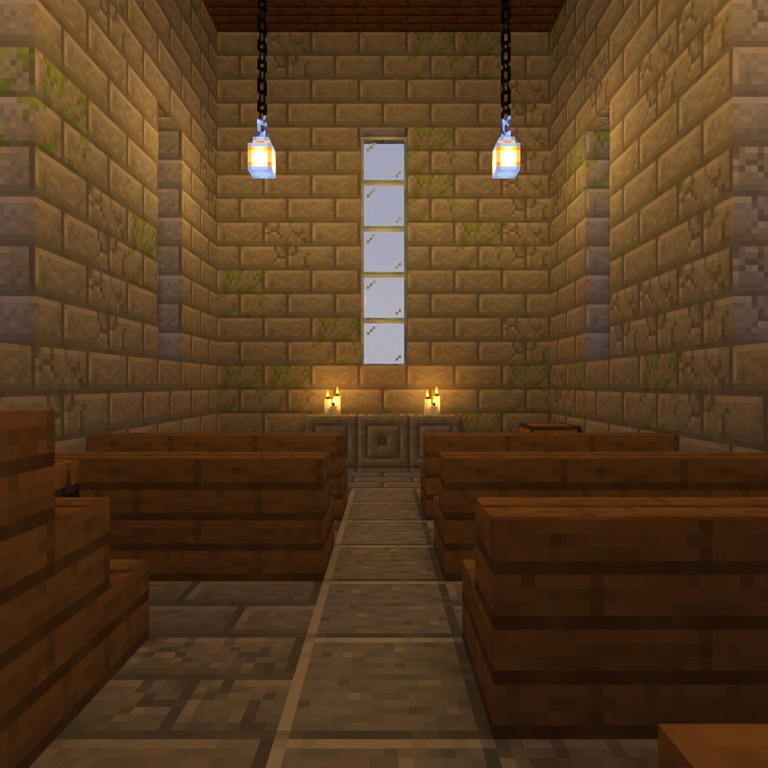

# An Item Laid at a Place

> **Requires delve engine 0.51.0 or newer** — last verified with delvec 1.13.0 on Minecraft Java 1.21.11.



Tomorrow at first light the men of Wending Cross answer to their names in the
chapel, and the names are read from the loft. The roll has spent the year in
the vestry chest. Tonight it goes up the loft stair and onto the lectern, and
a lantern goes on the hook above it, so that whoever keeps the night watch can
see the names are still there.

One to four players, about ten minutes. You arrive at dusk as the **Parish
Clerk**, with the vestry key and a little bread.

## Playing it

Start the server, then in the Minecraft Java client at the version the marker
above names: Multiplayer → Direct Connect → `localhost:25565`. Accept the
server's resource pack: it carries the Chinese text.

## What this level is for

It is the demo level for **an item laid at a place**. An objective that says
*lay*, *hang* or *give* is done only when the thing leaves your hand at the
place: you hold it, you use the place, and one of it is gone from your
inventory at that moment. The engine also reads every objective's first word
against what completes it, and refuses a title that promises one act and
rewards another.

## What to look for

1. **Nothing completes on arrival.** Before you take anything, climb the stair
   by the west wall into the loft. The lectern and the chain's hook are there
   already. Stand at them. Does any objective complete? Use the lectern with
   an empty hand: do you get a line saying the roll goes here, and nothing
   else?
2. **The roll leaves your hand at the click.** Take the muster roll out of the
   vestry chest beside the altar. Open your inventory: one *Muster Roll of
   Wending Cross*. Climb to the loft, hold the roll, and use the lectern. Is the
   roll gone from your inventory the moment you click, and does *Lay the roll
   on the lectern* complete on that same click?
3. **The lectern shows it.** Does the lectern now carry an open book on its
   slope? (Open it if you like: see *What this level does not show*.)
4. **The lantern, the same way.** Take the watch lantern out of the barrel at
   the foot of the stair, climb back up, hold it and use the end of the chain
   beside the lectern. Is the lantern gone from your hand at the click, does a
   lantern now hang from the chain, and does it light the lectern?
5. **The wrong hand.** Try the hook while holding the roll, or the lectern while
   holding the lantern. Does it refuse, and keep what you hold?
6. **Two players.** If a second player is with you, let one hold the roll and
   the other click the lectern empty-handed. Does it only complete for the one
   who presents the roll, and only that player's roll go?

## The machine record

The build that ships (`delvec build`, exit 0, twice, byte-identical: 115 files):

```
act binding (DW1045): 4 of 4 English title(s) read against 4 objective(s); 0 head(s) the lexicon does not know; 0 untitled; 0 refused
```

- PackTest: all 21 required tests passed, among them `verb_interact`, which
  holds two rolls in the player's hand and inventory, clicks the lectern, and
  asserts the objective is complete and the count is one lower (2, then 1).
- Bot critical path: passed in 6 steps — the class, the chest, the barrel, the
  lectern holding the roll, the hook holding the lantern, the ending.
- The world the server wrote equals the engine's model at every compared cell
  (1153), outside 2 grass cells the server turns to dirt under a wall.
- Drop `takes_item` from the roll's objective and the build refuses:

```
DW1045 [error] quests /content/quests/0/objectives/2/title: objective `obj/lay-the-roll` is titled "Lay the roll on the lectern": its head `lay` → give, and its completion `interact + requires_item` → use, present, so the title tells the player to do something the game does not reward (spec-0114). Either change the completion to the act the title names: add `takes_item: true`, so one `minecraft:paper` leaves the hand that presents it; or re-head the title with a word of what the completion performs (use, present: `use`, `present`, `activate`)
```

- Staging gate: refused with 2 of 135 findings unbound, both for the design
  record a demo level does not carry (`drill3-01`, `drill3-03`). Serving it
  takes the gate's own override.

## What this level does not show

- **The roll cannot be read on the lectern.** The lectern shows a book because
  its block says it has one, and that is all a placed block can say: what the
  book holds is not written. Open the lectern and the book is empty. In
  adventure mode the book cannot be taken off the lectern, so the roll stays
  shown.
- **The roll on the lectern is a book; in your hand it is paper.** The lectern
  only ever shows a book.
