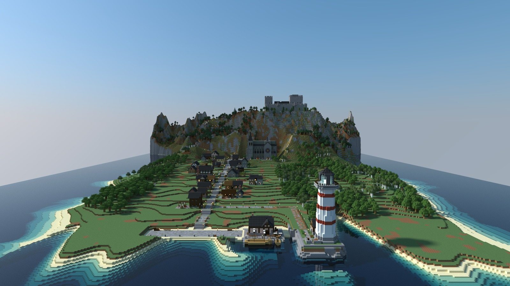
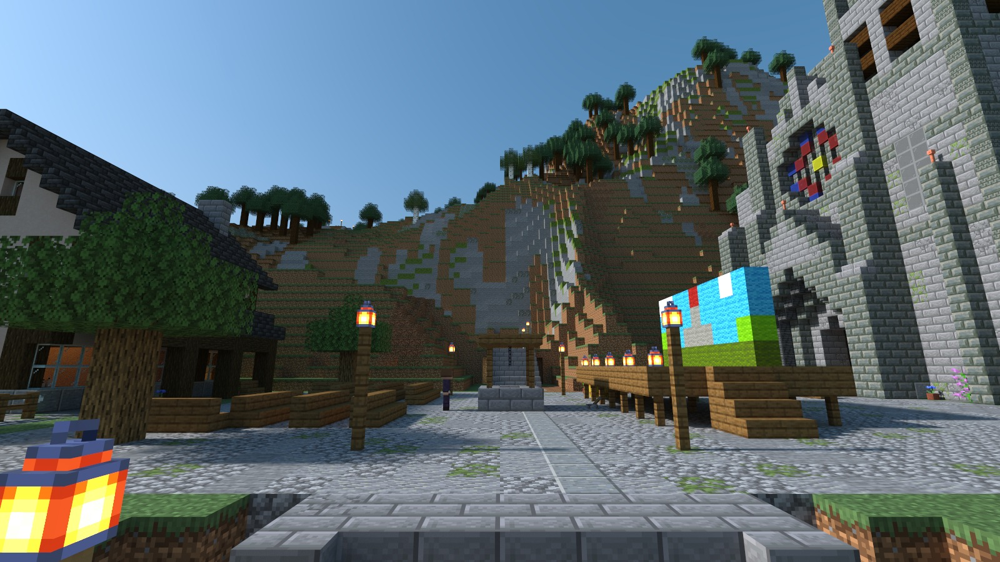
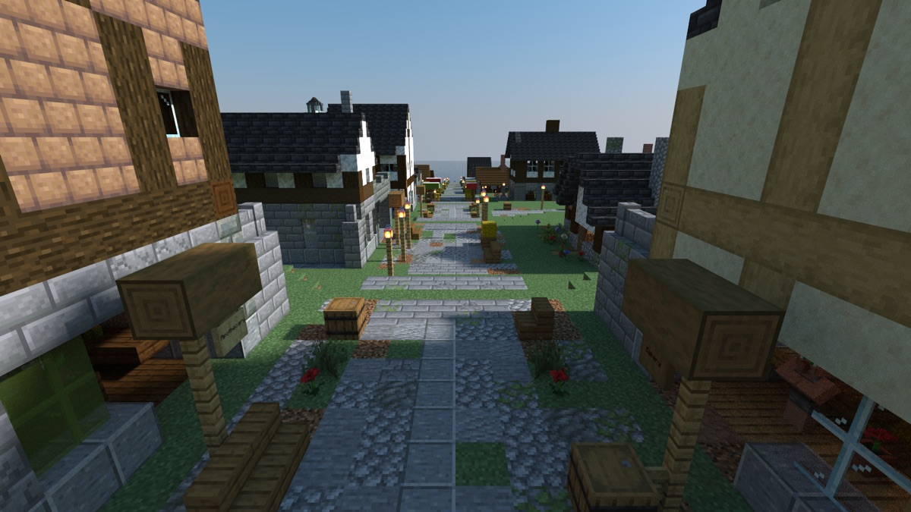

# Curtain Up in Kelderby

> **Requires delve engine 0.69.0 or newer** — last verified with delvec 1.15.0 on Minecraft Java 1.21.11.

A cheerful delve for a small party: a stone-and-timber harbour town on the slope below a castle mountain, on the one afternoon of the year it puts on its play.



| | |
|---|---|
| **Players** | 1–4 |
| **Playtime** | about two and a half hours |
| **Mode** | adventure, no combat |
| **Languages** | English, 简体中文 (`zh-cn`) |
| **Classes** | four — the Lead, the Prompter, the Musician, the Stagehand |
| **Licence** | CC BY-SA 4.0 |

## The story so far

Kelderby is a harbour town at the foot of a mountain: one main street stepping down from the cathedral square to the quays, side streets full of workshops, a lighthouse out on the headland, and a castle at the top of a long road. Every year, on the cathedral square, the town performs the Founders' Play, the story of how the town began.

You are a small travelling company, walking into town on the afternoon of the play. The innkeeper is waiting on the square, and she is very glad to see you. She seems to think you are someone else.

## Who you will meet

**Hedda Brask** — keeper of The Bell, the inn on the square, and director of the play every year. Brisk, warm and short of time.

**Lady Agathe Holm** — the old lady of the castle, who has played the play's Dragon for thirty years. **Bernt**, her steward, keeps the castle for her, and **Dumpling**, her happy ghast, keeps her company.

**Sanna** — a young net-mender, cast this year as the Founder. **Inga**, her aunt, keeps the lighthouse.

**Oskar** — the baker, who bakes the Mountain Loaf every year. **Runa** — the smith across the street, who mended his oven door.

**Fenna** — keeper of the sailors' tavern and leader of the town's shanty chorus, with **Kettil** the cooper, **Mari** of the net loft and **Sverre** the boatwright.

**Elin** — the weaver, who has made the play something new. **Vidar Foss** — the guildhall clerk, who knows the town's by-laws by heart.



## What kind of delve this is

A day in a busy town, in adventure mode: errands that send you searching yards and castle rooms, a little puzzling, people worth overhearing, and a lot of conversations. Nothing in Kelderby is hostile, and nobody can be hurt.

**Talking.** Right-click a townsperson to talk; choose an answer from the list. What you choose is remembered.

**Looking around.** Kelderby rewards the curious: notices, letters and odd things left about the town can be read by right-clicking them, and some of them change what people will say to you. Each find puts a penny in your purse, shown at the side of the screen, and the merchant's stall on the main street has things to spend it on.

**The compass and the journal.** Your compass points at what you are doing next; right-click it to choose between errands. Your journal lists them all.

**Getting about.** The main street steps down from the square to the harbour in short flights. The castle road climbs the mountain in long zig-zags; the cliff path to the lighthouse leaves the lower town by the harbour.

**Pack nothing.** Each class carries what its part needs and bread for the walk.



## Play it

One command and the town is up — then, in the Minecraft Java client at the version the marker above names: Multiplayer → Direct Connect → `localhost:25565`:

```sh
docker run -d --name delve -p 25565:25565 -v delve-data:/data \
  -e EULA=TRUE ghcr.io/stellarfeline/delve-foot-of-the-mountain:latest
```

That is the current delve. To hold it at one exact version, take the `:vX.Y.Z` tag from a release page instead; every release names its own. Your client will offer a resource pack when you join (the Chinese text); accept it. To start the story over, `docker rm -f delve && docker volume rm delve-data`, then run the same command again.

---

*The design of this campaign and the decisions behind it are recorded in `DESIGN.md` and `GENERATION.md`. Those files discuss the whole story, including its endings, and are not spoiler-safe.*
