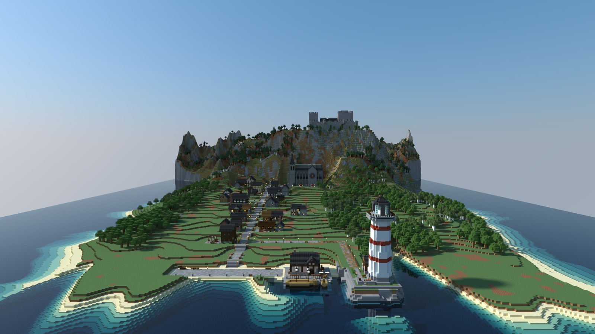
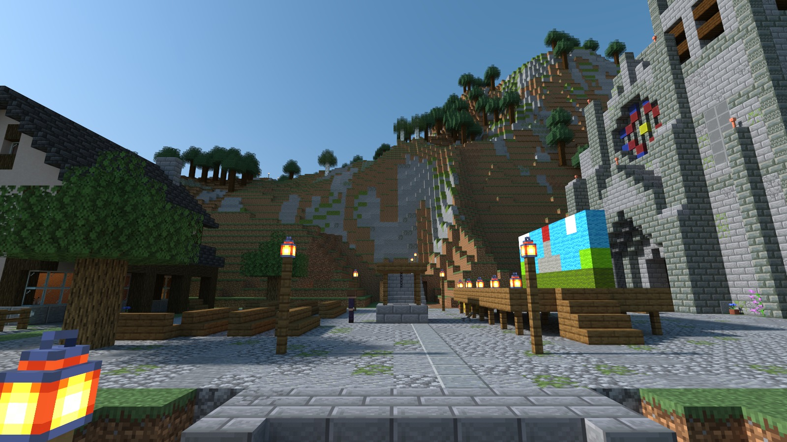
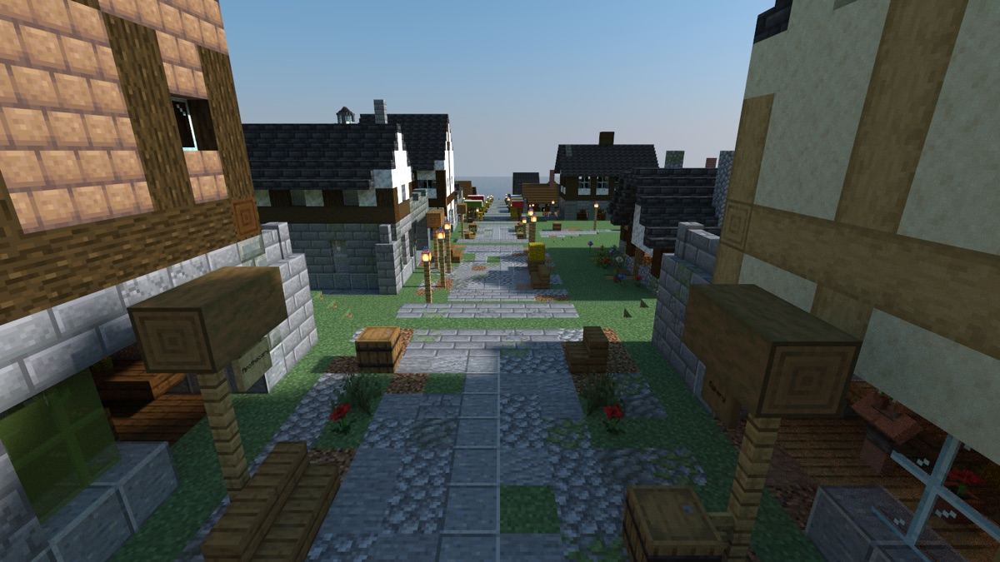

# Festival Day in Kelderby

> **Requires delve engine 0.76.0 or newer** — last verified with delvec 1.16.0 (the festival-day engine) on Minecraft Java 1.21.11.

A cheerful delve for a small party: a stone-and-timber harbour town on the slope below a castle mountain, on the one day of the year it holds its festival.



| | |
|---|---|
| **Players** | 1–4 |
| **Playtime** | about two and a half hours |
| **Mode** | adventure; one fight, at dusk |
| **Languages** | English, 简体中文 (`zh-cn`) |
| **Classes** | four — the Watch, the Archer, the Runner, the Cook |
| **Licence** | CC BY-SA 4.0 |

## The day

Kelderby is a harbour town at the foot of a mountain: one main street stepping down from the cathedral square to the quays, side streets full of workshops, farms and pens out on the flank, a lighthouse on the headland, and a castle at the top of a long road.

You wake in town on the morning of its festival. The host climbs onto the stage on the square to open the day, and at once everything goes wrong. The day is yours to put right, the dusk has to be got through, and the night is the festival — made of whatever the day managed.



## What kind of delve this is

A busy day in a small town, in adventure mode: the town's troubles, big and small, each its own errand across the map, some of them against the clock. Bright and comic for most of the day; there is one fight, when the light goes.

**Talking.** Right-click a townsperson to talk; choose an answer from the list. What you choose is remembered, and the festival at the end is made of what you did.

**The compass and the journal.** Your compass points at what you are doing next; right-click it to choose between errands. Your journal lists them all, and keeps a line for each one you finish.

**Getting about.** The main street steps down from the square to the harbour in short flights; the castle road climbs the mountain in long zig-zags; the cliff path to the lighthouse leaves the lower town by the harbour. Not every errand is done on foot.

**Pack nothing.** Each class carries what its part needs, and bread.



## Play it

One command and the town is up — then, in the Minecraft Java client at the version the marker above names: Multiplayer → Direct Connect → `localhost:25565`:

```sh
docker run -d --name delve -p 25565:25565 -v delve-data:/data \
  -e EULA=TRUE ghcr.io/stellarfeline/delve-foot-of-the-mountain:latest
```

That is the current delve. To hold it at one exact version, take the `:vX.Y.Z` tag from a release page instead; every release names its own. Your client will offer a resource pack when you join (the Chinese text); accept it. To start the story over, `docker rm -f delve && docker volume rm delve-data`, then run the same command again.

---

*The design of this campaign and the decisions behind it are recorded in `DESIGN.md` and `GENERATION.md`. Those files discuss the whole story, including its endings, and are not spoiler-safe.*
