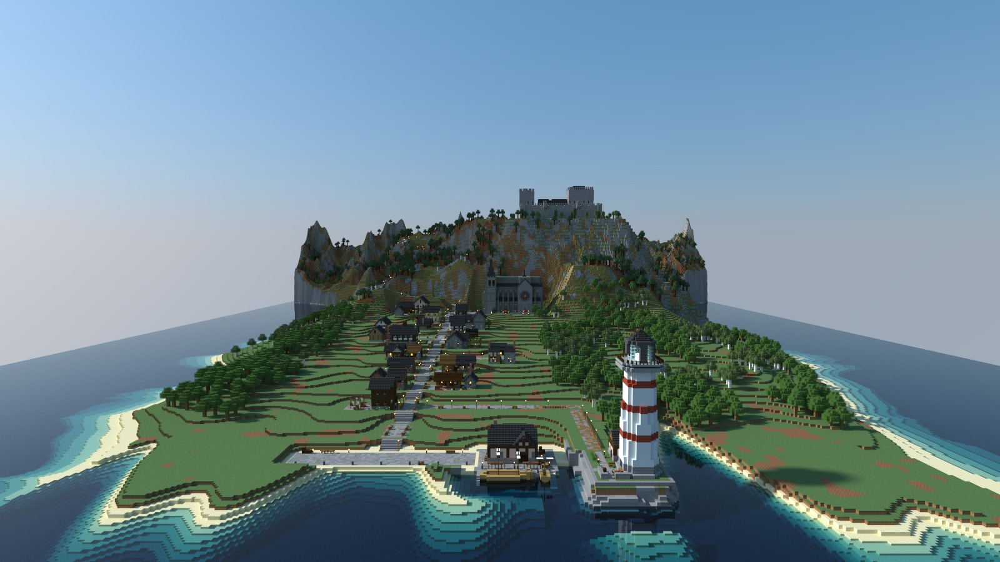
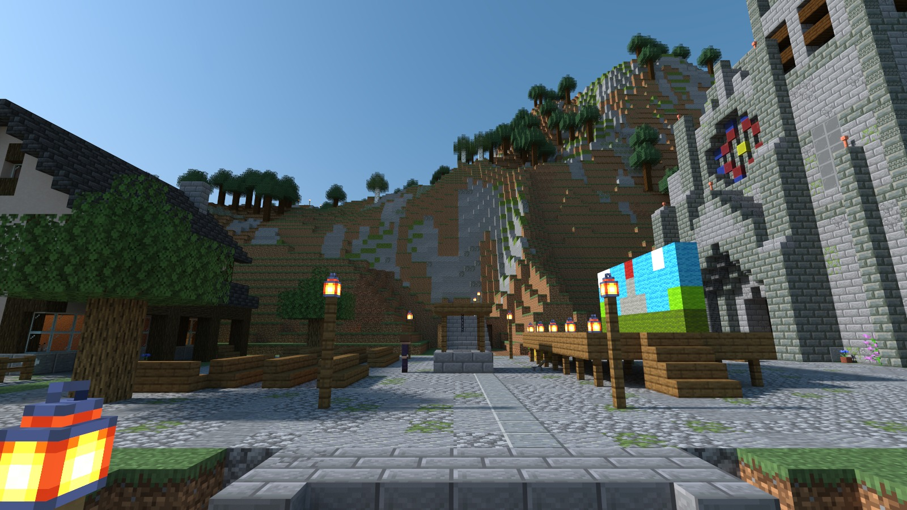
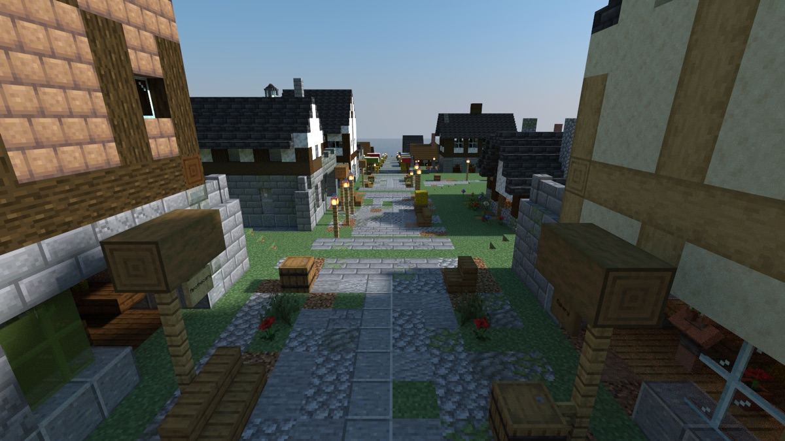

# 凯尔德比的庆典日

> **需要 delve 引擎 0.76.0 或更新版本** —— 最近一次用 delvec 1.16.0（庆典日引擎）在 Minecraft Java 1.21.11 上验证。

一场适合小队的轻松冒险：一座石木结构的海港小镇，坐落在城堡山下的山坡上，正逢它一年一度的庆典日。



| | |
|---|---|
| **玩家** | 1–4 |
| **游玩时间** | 约两个半小时 |
| **模式** | 冒险模式；白天有点小冲突，黄昏时有一场大战 |
| **语言** | English, 简体中文 (`zh-cn`) |
| **职业** | 四种——巡夜人、弓手、跑腿、厨子 |
| **许可** | CC BY-SA 4.0 |

## 这一天

凯尔德比是山脚下的一座海港小镇：一条主街从大教堂广场一级级往下通到码头，两边的小巷里挤满了作坊，山坡上是农田和牲口圈，岬角上立着灯塔，长长的山路尽头是城堡。

你在庆典日的早晨醒在镇上。主持人登上广场的舞台宣布开幕——话音未落，一切就乱了套。白天归你来收拾，黄昏得熬过去，到了夜里便是庆典：白天办成了多少，庆典就有多热闹。



## 这是一场什么样的冒险

小镇里忙碌的一天，冒险模式：镇上大大小小的麻烦，各是一桩跑遍地图的差事，有几桩还得赶时间。一天里大多轻松滑稽，路上偶尔有点小冲突；天色暗下来时，才是那场大战。

**交谈。** 右键点击镇民即可交谈，从列表里选一个回答。你的选择会被记住，最后的庆典就由你做过的事拼成。

**指南针和日志。** 指南针指向你接下来要做的事；右键点击它可以在几桩差事之间切换。日志列出所有差事，每办完一桩，都会记下一行。

**出行。** 主街从广场一段段台阶往下通到港口；城堡山路在山上来回盘旋；去灯塔的崖边小路从港口旁的下城出发。不是每桩差事都靠走路。

**什么都不用带。** 每个职业都带着自己用得上的东西，还有面包。



## 开玩吧

一条命令，小镇就会启动——然后，在上面标注的版本对应的 Minecraft Java 客户端中：多人游戏 → 直连 → `localhost:25565`：

```sh
docker run -d --name delve -p 25565:25565 -v delve-data:/data \
  -e EULA=TRUE ghcr.io/stellarfeline/delve-festival-day-in-kelderby:latest
```

这就是当前的冒险地图。如果想固定在某一个确切版本，请改从发布页获取 `:vX.Y.Z` 标签；每个版本都会标明自己的标签。加入时客户端会提示你使用资源包（中文文本）；请接受。要重新开始故事，请先运行 `docker rm -f delve && docker volume rm delve-data`，然后再运行一次上面的命令。

---

*本战役的设计及其背后的决策记录在 `DESIGN.md` 和 `GENERATION.md` 中。这些文件会讨论整个故事，包括结局，因此不适合怕剧透的玩家阅读。*
