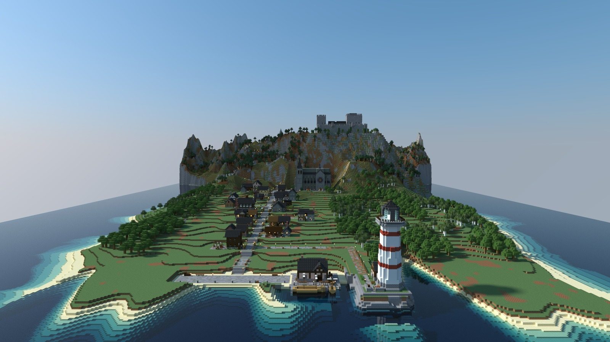
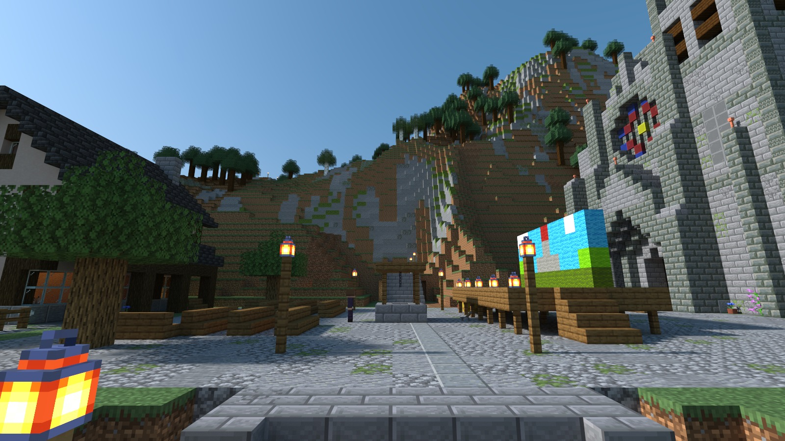
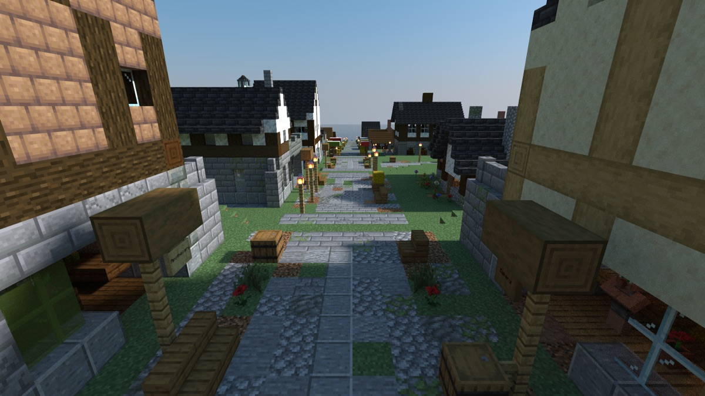

# 凯尔德比大幕拉开

> **Requires delve engine 0.69.0 or newer** — last verified with delvec 1.15.0 on Minecraft Java 1.21.11.

一场适合小队的轻松冒险：一座石木结构的海港小镇，坐落在城堡山下的山坡上，正逢一年中它上演自己戏剧的那个下午。



| | |
|---|---|
| **玩家** | 1–4 |
| **游玩时间** | 约两个半小时 |
| **模式** | 冒险，无战斗 |
| **语言** | 英语、简体中文 (`zh-cn`) |
| **职业** | 四种——主角、提词人、乐师、剧务 |
| **授权协议** | CC BY-SA 4.0 |

## 前情提要

凯尔德比是一座山脚海港小镇：一条主街从大教堂广场一路向下通往码头，小巷里满是工坊，半岛尽头有座灯塔，漫长山路的顶端还有一座城堡。每年，小镇都会在大教堂广场演出“创镇者之剧”，讲述这座镇子如何诞生。

你们是一个小小的巡演剧团，在演出当天下午走进镇子。旅馆老板娘正在广场上等着，见到你们高兴极了。她似乎把你们当成了别人。

## 你会遇见的人

**赫达·布拉斯克**——广场上“大钟”旅馆的老板娘，每年戏剧的导演。爽快、热心，总缺时间。

**阿加特·霍尔姆夫人**——城堡里的老夫人，在剧中扮演了三十年的巨龙。她的管家 **贝恩特** 替她照看城堡，而她快乐的恶魂 **团子** 陪她作伴。

**桑娜**——年轻的补网姑娘，今年被选中饰演创镇者。她的姑妈 **英加** 看守灯塔。

**奥斯卡**——面包师，每年都会烤制“山地面包”。**鲁娜**——街对面的铁匠，帮他修好了烤炉门。

**芬娜**——水手酒馆的老板娘，也是镇上船歌合唱队的领唱；跟她一起的有箍桶匠 **凯蒂尔**、网棚的 **玛丽** 和造船匠 **斯韦雷**。

**埃琳**——织布工，她让这部剧有了新气象。**维达尔·福斯**——公会堂的文书，镇上的规章条例烂熟于心。



## 这是一次怎样的冒险

在冒险模式中，繁忙小镇的一天：差事让你搜寻庭院和城堡房间，一点解谜，值得偷听的人们，以及大量对话。凯尔德比没有任何敌意，也无人会受到伤害。

**交谈。** 右键点击一位镇民即可交谈；从列表中选择一个回答。你的选择会被记住。

**四处看看。** 凯尔德比奖励好奇心：镇上散落的告示、信件和奇怪物件都可以右键点击阅读，其中一些会改变人们对你说的话。每找到一件，你的钱袋里就会多一枚便士，显示在屏幕一侧；主街上的商人摊位有可供花费的东西。

**指南针与日志。** 你的指南针会指向你接下来要做的事；右键点击它可以在不同差事之间选择。你的日志会列出所有差事。

**四处走走。** 主街从广场分几段短台阶向下通往海港。城堡大路沿着长长的之字形爬上山坡；通往灯塔的崖边小路从下城区靠近海港的地方离开。

**什么都不用带。** 每个角色都会带上自己职责所需的东西，还有路上吃的面包。



## 开玩吧

一条命令，小镇就会启动——然后，在上面标注的版本对应的 Minecraft Java 客户端中：多人游戏 → 直连 → `localhost:25565`：

```sh
docker run -d --name delve -p 25565:25565 -v delve-data:/data \
  -e EULA=TRUE ghcr.io/stellarfeline/delve-foot-of-the-mountain:latest
```

这就是当前的冒险地图。如果想固定在某一个确切版本，请改从发布页获取 `:vX.Y.Z` 标签；每个版本都会标明自己的标签。加入时客户端会提示你使用资源包（中文文本）；请接受。要重新开始故事，请先运行 `docker rm -f delve && docker volume rm delve-data`，然后再运行一次上面的命令。

---

*本战役的设计及其背后的决策记录在 `DESIGN.md` 和 `GENERATION.md` 中。这些文件会讨论整个故事，包括结局，因此不适合怕剧透的玩家阅读。*
