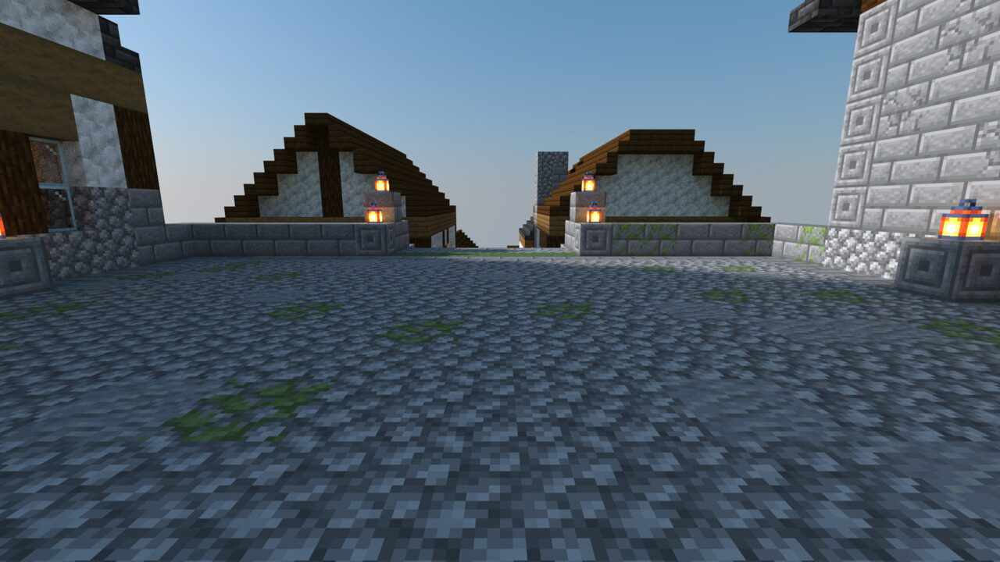

# Saltstair

> **Requires delve engine 0.56.0 or newer** — last verified with delvec 1.14.0 on Minecraft Java 1.21.11.

A short walk through a fishing town on the seaward end of a long green peninsula: one street, five stone terraces, and the sea at the bottom of it.



| | |
|---|---|
| **Players** | 1–4 |
| **Playtime** | ~10 minutes |
| **Mode** | adventure, no combat |
| **Languages** | English |
| **Class** | one — Visitor |
| **Licence** | CC BY-SA 4.0 |

## The town

Saltstair is a fishing town. One street climbs from the quay to a square at the top of the hill in five terraces, each a flight of stone steps above the last, and the houses stand on the terraces, so from the sea their roofs step up the hill the way the street does. The fishermen named the town after the street.

At the top is the square, with a small stone chapel on one side and the Lantern, a wide timber-framed inn, on the other. Below it a smithy and a weaver's house, a merchant's tall house, a long rope walk, the harbourmaster's narrow house, and at the water a stone warehouse beside the quay. It is a fine afternoon, and nothing in the town is hostile.

## What kind of delve this is

A walk, in adventure mode. You arrive on the square and go down the main street to the quay. Every flight has a lantern at its kerb posts and every door a lantern beside it. The hillside beside the street is open turf.

You are given what a visitor carries: a little bread for the walk.

## Play it

Start the server, then in the Minecraft Java client at the version the marker above names: Multiplayer → Direct Connect → `localhost:25565`:

```sh
docker run -d --name delve -p 25565:25565 -v delve-data:/data \
  -e EULA=TRUE ghcr.io/stellarfeline/delve-saltstair-a:latest
```

That is the current delve. To hold it at one exact version, take the `:vX.Y.Z` tag from a release page instead; every release names its own. Accept the resource pack your client offers when you join. To start over, `docker rm -f delve && docker volume rm delve-data`, then run the same command again.

Add `-e DELVE_RESET_WHEN_EMPTY=90` and the world is thrown away and built again from the image once nobody has been online for 90 seconds, so the next arrival starts a delve nobody has touched — but then EVERY start resets, and restarting the container under a party ends that party's run. Leave it out and the world is kept. The floor is 60 seconds; below it the server refuses to start.

---

*The design of this campaign and the decisions behind it are recorded in `DESIGN.md` and `GENERATION.md`. Those files discuss the whole walk, including where it ends, and are not spoiler-safe.*
