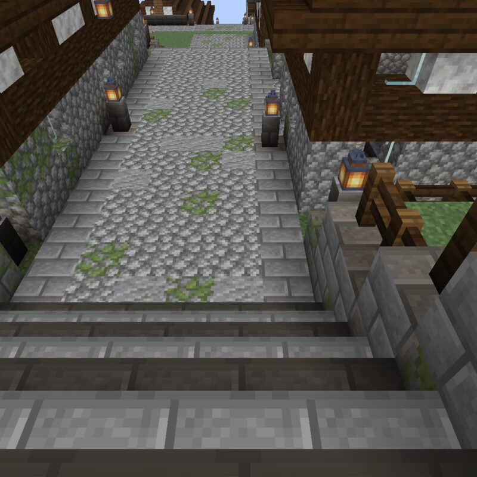

# Saltstair

> **Requires delve engine 0.56.0 or newer** — last verified with delvec 1.14.0 on Minecraft Java 1.21.11.

A short walk through a fishing town that climbs a hillside above its quay, on the seaward end of a long green peninsula.



| | |
|---|---|
| **Players** | 1–4 |
| **Playtime** | ~10 minutes |
| **Mode** | adventure, no combat |
| **Languages** | English |
| **Class** | one — Visitor |
| **Licence** | CC BY-SA 4.0 |

## The town

Saltstair is a town of stone and timber on a steep hill above the sea. One street climbs from the quay to a square at the top, in terraces joined by flights of stone steps, and the houses stand on the terraces, so from the water their roofs step up the hill the way the street does. The fishermen named the town after the street.

A small stone chapel and the Lantern, a wide timber inn, face each other across the square. Below them stand a smithy, a weaver's house, a merchant's tall house, a long rope walk, the harbourmaster's narrow house and, at the water, the warehouse on the quay. It is a clear midday, and the town is at its work.

You arrive on the square, having come over the hill road with a loaf in your pack.

## What kind of delve this is

A walk, in adventure mode. Nothing in the town is hostile. The street is the way; the hillside beside it is fenced turf, and the mainland running north beyond the town is not part of the walk — wander too far from the town, or swim out past the quay, and you are brought back.

## Play it

One command and the town is up — then, in the Minecraft Java client at the version the marker above names: Multiplayer → Direct Connect → `localhost:25565`:

```sh
docker run -d --name delve -p 25565:25565 -v delve-data:/data \
  -e EULA=TRUE ghcr.io/stellarfeline/delve-saltstair-b:latest
```

That is the current delve. To hold it at one exact version, take the `:vX.Y.Z` tag from a release page instead; every release names its own. To start the walk over, `docker rm -f delve && docker volume rm delve-data`, then run the same command again.
