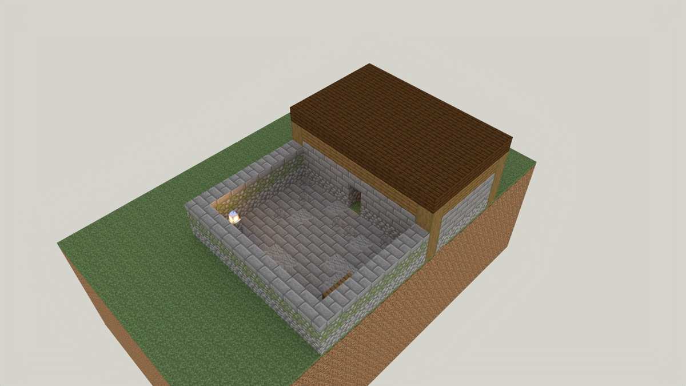

# The Armoury

> **Requires delve engine 0.49.0 or newer** — last verified with delvec 1.13.0 on Minecraft Java 1.21.11.

Greyholt is a stone watch-house on the moor road, and Ide Fenwick has kept it
for thirty winters. She is going down to the valley at last, and the new watch
has come up the road to take the post. The post goes with its sword, and the
sword is on the rack in the armoury.

A demo level of about ten minutes, for one to four players. No combat.

## Who you will meet

- **Ide Fenwick** keeps the watch-house at Greyholt. Her pack has been by the
  door since the thaw.

## Classes

- **New Watch** — your own bow, a few arrows and some bread. You came up the
  moor road to stand the watch.

## Playing it

Start the server, then in the Minecraft Java client at the version the marker
above names: Multiplayer → Direct Connect → `localhost:25565`. Accept the
resource pack when the server offers it.

---

## For the owner: what to look for

This level is where item holders (spec-0111) are looked at in the game: an
item sits where the scene would hold it, and a player in adventure mode takes
it by the game's own act without being able to take or break what held it.
The machine has proved the census — five holders in the armoury: three armour
stands, a glow item frame and a chest — that every one holds something, that
each entity holder hangs on something solid or stands on a floor, that a body
can stand within reach of each with nothing in the way, and that the engine
summons each with the flags it owns. The bot took the sword from its stand.
What the machine cannot say is how any of it **reads**. Walk it once as the
New Watch, and take whatever you would naturally take.

**Open in this build, do not judge it yet: the sword is on its stand's
head.** The quest's sword can only be put in a stand's head slot by this
engine revision, so the middle stand wears the sword where a helmet goes. The
level is right in every other respect; the sword moves into the stand's hand
once the engine lets the quest name the slot. Items 1 and 2 below are about
that stand, and stay open until then.

1. **The worn sword is yours to take.** Ide tells you the post goes with its
   sword, the sword is on the rack, and to bring it out. She does not say how.
   Walk into the armoury through the door behind her. Do you understand,
   without being told, that the sword on the middle stand of the rack along
   the left-hand wall is yours to take off it?
2. **Where you click on a stand.** Note where on each stand you click first,
   and whether the first click takes the item. The game decides which slot a
   click takes by the height of the click: a helmet comes off only to a click
   on the head; an item in a hand comes off to a click anywhere else on the
   stand.
3. **The helmet, the shield and the map can be taken.** The stand nearest
   the door wears the watch helmet; the stand nearest the window holds a
   shield on its off arm; the glow frame on the inside of the door wall, on
   the side away from the rack, holds the map of the moor road. Each should come away into
   your inventory: the helmet and the shield by a click on the stand, the map
   by a hit on the frame, which drops it at your feet. A right-click on the
   frame turns the map and takes nothing.
4. **Nothing lets you break or carry off a holder.** Hit the stands, emptied
   or not; hit the frame again once it is empty; try to hang something on an
   emptied stand or put something in the empty frame. Each stand and the
   frame should stay where it is, and nothing should go onto them. Note any
   frame item or stand item that reaches your inventory.
5. **The chest under the window holds arrows and nothing else.** Open it.
   Does a chest of arrows under the window read as part of an armoury, and
   does it make sense to someone carrying a bow?

Bring the sword out to Ide in the yard to finish.
