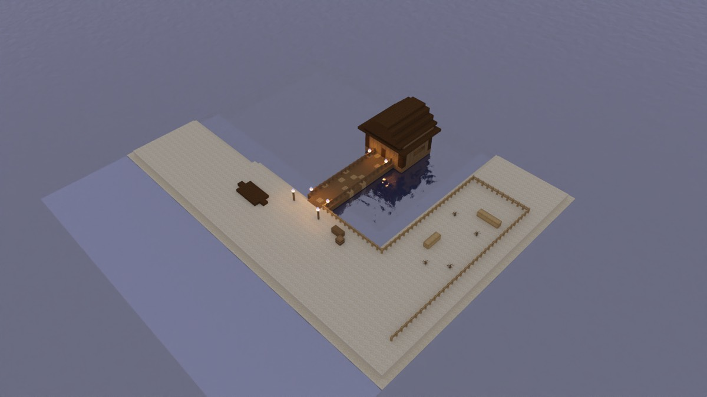
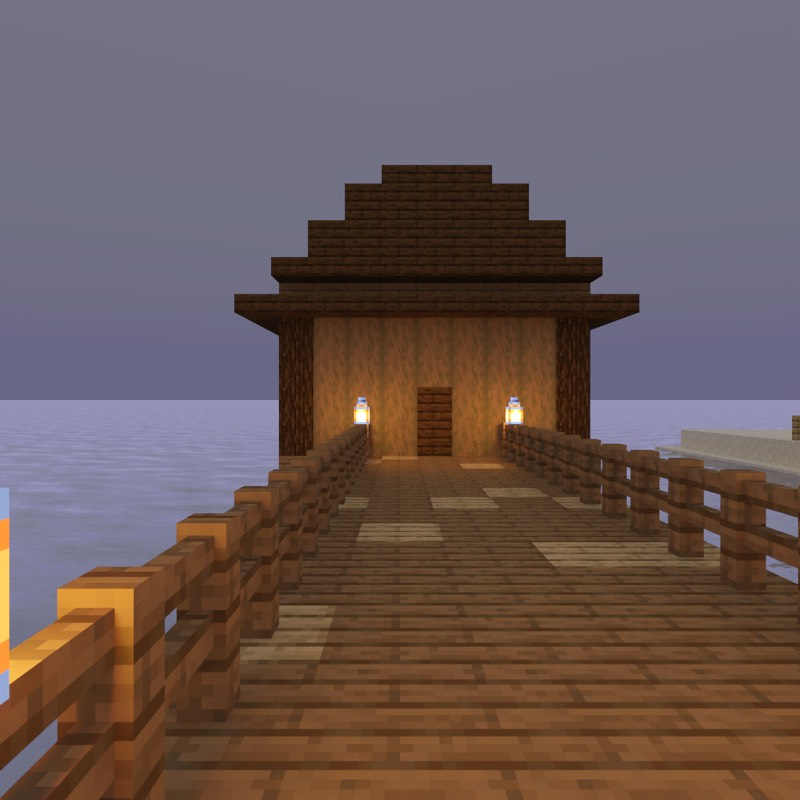

# The Ferry Bell

> **Requires delve engine 0.56.0 or newer** — last verified with delvec 1.14.0 on Minecraft Java 1.21.11.



A wet afternoon on a sandy shore. The ferry lies over on the far side of the sound, and it only crosses when its bell is rung. The bell is in the ferry house at the end of the jetty, bolted in. Nell Garrow has kept it for thirty years, and she will not ring it alone: the last three times it rang, the dead came up out of the cove onto the spit across the water.

| | |
|---|---|
| **Players** | 1–4 |
| **Playtime** | ~10 minutes |
| **Mode** | adventure, one fight |
| **Languages** | English, 简体中文 (`zh-cn`) |
| **Class** | one — Traveller |
| **Licence** | CC BY-SA 4.0 |

One to four players, about ten minutes. You arrive as a **Traveller** with a
boathook, an oilskin and a heel of bread — and, like everyone, a compass and a
journal.

**Nell Garrow**, the ferry-keeper, waits in the rain at the foot of the jetty
with one arm tucked into her coat.

## Playing it

Start the server, then in the Minecraft Java client at the version the marker
above names: Multiplayer → Direct Connect → `localhost:25565`. Accept the
server's resource pack: it carries Nell's face and the Chinese text.



## What this level is for

It is the demo level for **guidance a player can follow**. Every player carries
a compass that points at one open task, and right-clicking it opens the list of
open tasks to choose from. A lever that does not look like a door's bolt glows
once someone is close to it. And every player holds a journal: how the compass
works, Nell's notes, the open tasks with the one you follow marked, and the
finished ones struck through.

## What to look for

Play it with two players if you can; a few items need a second body.

1. **The compass menu.** Talk to Nell and say you will ring the bell. Two tasks
   open at once: *Read the ferry notice* and *Ring the ferry bell*; chat shows
   each one's title and hint (the notice: *On its post at the jetty's head, right
   of the planks*) with a chime. Does the hint alone get you to it? Hold the
   compass and right-click. Does a list of the open tasks appear, with the one
   you follow marked ◆? Pick the other one. Does the needle turn to it, and
   does chat say *Following: …*?
2. **Two compasses, two ways.** Standing beside Nell, one player picks the bell
   from the list and the other follows the notice. The notice is a few steps to
   one side, at the jetty's head; the bell is straight out along the jetty, in
   the ferry house. Do the two needles point different ways?
3. **The lever glows only up close.** The ferry-house door is bolted. From the
   shore the bolt lever is a plain lever on the deck beside the door. Walk out
   along the jetty. Does it start to glow, with a gold outline, only once you
   are on the last stretch of deck, within six blocks of it — and stop when you
   walk back? Does the glow read as *this one*? Pull it: does the door open?
   The bell inside carries no glow: does it still read as the bell?
4. **The journal reads in order.** Open the journal (right-click it). Does it
   go: the page about the compass, then two pages of *The Ferry-Keeper's Notes*
   (the first names the use key as your own binding), then one page per open
   task with its hint and the ◆ mark on the one you follow, then the finished
   tasks struck through? Open it again after you read the notice: has the notice
   moved to the struck-through pages, with the bell still open?
5. **Reconnect, or join late.** Disconnect on the jetty and come back, or have
   a second player join after the talk. Does the returning player hold the same
   journal as before, and does the late player hold one that already lists what
   is open and what is done?
6. **Every needle spins at the end.** Ring the bell; three of the dead form up
   on the spit across the water and come round the shore. When the last task is
   done, does every compass needle spin, and is every journal all struck-through
   pages?
7. **The arrival line.** As you arrive, chat says something about the barrels,
   with the sound of a barrel lid closing. The barrels on this shore are empty:
   after the line, do you go looking in them, or walk on to the jetty?

If you die in the fight you come back on the jetty, with the dead still
standing where they were.

## The refusal

The level was first built with the bolt lever on the jetty rail, among the
rail's spruce fence posts (`transcripts/lever-on-the-rail.txt`, `delvec build`
exit 3). From Nell, the rail's own fence hides it:

```
DW0863 binding: 5 act(s) over 1 walk(s) — 2 announced with a hint, 2 in sight (1 kill(s) also in reach), 1 trigger(s) judged by sight alone; 1 refused; 0 kill(s) on no walk judged from the acts that fire their wave
DW0863 [error] build: on the critical path, the `use` act `trigger/draw-the-bolt` cannot be found by the party: from `obj/hear-nell`'s cell ([8209, 64, 8210]) its target [8208, 64, 8198] is 12.1 blocks away and hidden: the line is stopped first at [8208, 64, 8203]. An act the party can see from where it stands needs no line; one it cannot see owes one. A trigger has no lines to say where it is, so its only remedy is the world: move `trigger/draw-the-bolt` or what it acts on into sight of where the party stands, or make the act an `interact` objective with a `hint`.
```

The lever was then moved off the rail to the deck beside the door, where Nell
sees it, and the level builds.

## The machine record

The build that ships (`delvec build`, exit 0, twice, byte-identical: 221 files):

```
DW0863 binding: 5 act(s) over 1 walk(s) — 2 announced with a hint, 3 in sight (1 kill(s) also in reach), 1 trigger(s) judged by sight alone; 0 refused; 0 kill(s) on no walk judged from the acts that fire their wave
act binding (DW1045): 4 of 4 English title(s) read against 4 objective(s); 0 head(s) the lexicon does not know; 0 untitled; 0 refused
hint act binding (DW1045): 0 of 2 English hint(s) name an act, over 4 objective(s); 0 warned
compass binding: 4 tracked objective(s) of 4 — 0 by their own field, 4 by the campaign default; 0 refused
highlight binding: 1 highlight(s) over 5 act(s) — 1 on a block, 0 on a body; 0 refused
journal pages: 14 page(s) measured over the source and every declared language, the fullest 14 of 14 line(s); 0 over
name-told binding (DW0982): 4 declared name(s); 1 walk(s); 10 of 10 dialogue string(s) and 6 of 6 objective string(s) on screen on some walk; 0 use(s) of a name in them, 0 untold
```

- PackTest: all 42 required tests passed, among them the seven guidance tests —
  the compass (aim, the menu's buttons, a pick, the spin, the re-give), the
  compass on a person, the compass on the fight, the lever's highlight (dark
  while closed, lit in range, dark beyond it), and the journal's pages, a
  dropped journal, and a joining player's journal.
- Bot critical path: passed — the talk, the bolt lever, the notice, the bell,
  the fight — and a scripted death in the fight came back on the jetty and
  re-engaged; Nell's turn to face the player was asserted 15 times; the
  arrival line about the barrels arrived with its sound.
- The world the server wrote equals the engine's model at every compared cell
  (17895), outside the named classes the server re-derives.

## Review frames

Two draft frames (`delvec snapshot --labels`), with the engine's labels burnt
in. They draw the world as it stands at load, so Nell, the notice, the
lever and the bell are not in them; their labelled boxes are. They were drawn
before Nell moved one block east and one south, to the foot of the jetty.

- `media/review/at-nell.jpg` — where the talk ends: Nell's box on the left, the
  notice's post (labelled `NOTICE`) on the right, and straight ahead the jetty
  running out to the ferry house, with the lever's box at its door: the two
  open tasks lie in two directions.
- `media/review/six-from-lever.jpg` — six blocks short of the lever along the
  deck, the distance at which it starts to glow.

## What this level does not show

- **The notice is blank.** The engine cannot yet write a placed sign's text; the
  notice's words arrive in chat when you click it.
- **Rain.** The renders above are drawn without rain, clouds or rain fog; in the
  game it is raining all through.
- **The empty barrels.** On arrival one chat line says the barrels on this
  shore stand empty: the engine owes that line wherever a container holds
  nothing.
- **The dead are zombies** — the dead of this shore, kept from burning in the
  daylight by the rain.
- **The glow, in a picture.** No frame here shows the highlight; whether it
  reads is judged in the game.
