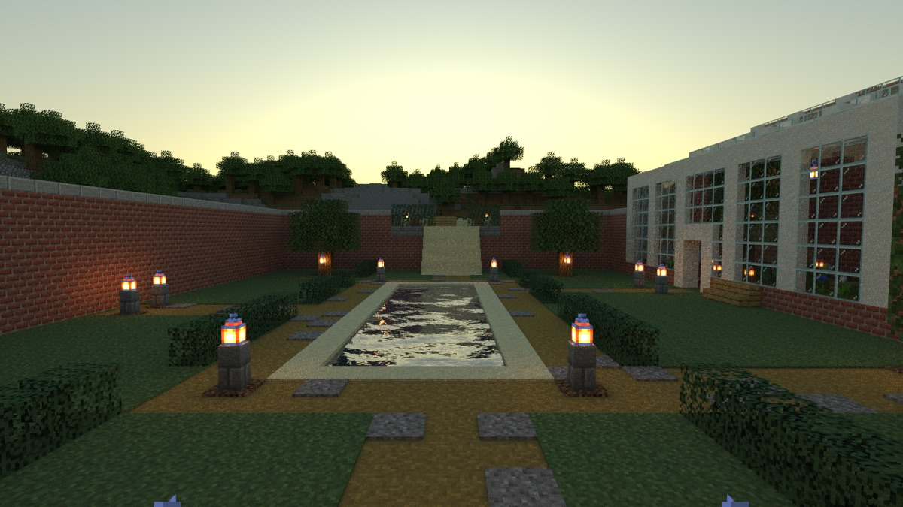
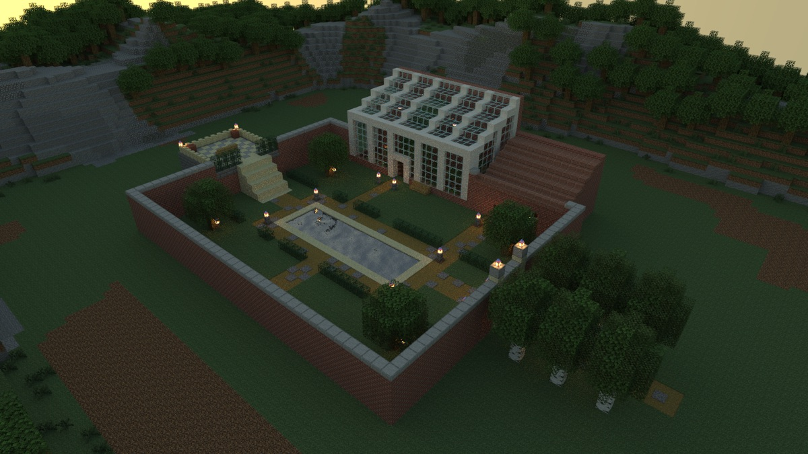

# The Glasshouse

> **Requires delve engine 0.39.0 or newer** — last verified with delvec 1.13.0 on Minecraft Java 1.21.11.

A short, quiet delve for a small party: an old walled kitchen garden on an upland shelf above a wide valley, a glass conservatory against its north wall, and one clear autumn evening when the first frost is coming.



| | |
|---|---|
| **Players** | 1–4 |
| **Playtime** | ~12 minutes |
| **Mode** | adventure, no combat |
| **Languages** | English |
| **Classes** | two — Visitor, Garden Apprentice |
| **Licence** | CC BY-SA 4.0 |

## The story so far

The walled garden belongs to an old estate. Its brick walls keep the wind off the beds and the fruit trees, a long still pool lies down the middle of the lawns, and against the north wall, where the sun reaches all day, stands a conservatory of glass in white frames. In it grows a lemon tree older than anyone who works there now.

You are visitors walking the estate at the end of the day. The sky is clearing as the sun goes down, and in this valley a clear evening in autumn means frost before morning. A lamp is lit in the potting room beside the conservatory.

## Who you will meet

**Wenna Hale** — the head gardener. She has kept this garden for forty years, and she would rather do everything herself.



## What kind of delve this is

A walk through a garden at sunset, in adventure mode. Nothing here is hostile.

**The light.** The day is ending as you arrive. The garden's paths are lit by lanterns on short posts, and the rooms are lit by lamp and candle.

**Pack nothing.** You carry what a visitor or a Saturday garden hand would carry: a coat and an apple, or secateurs and bread.

## Play it

One command and the garden is up — then, in the Minecraft Java client at the version the marker above names: Multiplayer → Direct Connect → `localhost:25565`:

Set your render distance to at least 16 chunks (Options → Video Settings) — the far views this delve was designed with are not drawn below it.

```sh
docker run -d --name delve -p 25565:25565 -v delve-data:/data \
  -e EULA=TRUE ghcr.io/stellarfeline/delve-the-glasshouse:latest
```

That is the current delve. To hold it at one exact version, take the `:vX.Y.Z` tag from a release page instead; every release names its own. Your client will offer a resource pack when you join (the gardener's face); accept it. To start the story over, `docker rm -f delve && docker volume rm delve-data`, then run the same command again.

Add `-e DELVE_RESET_WHEN_EMPTY=90` and the world is thrown away and built again from the image once nobody has been online for 90 seconds, so the next arrival starts a delve nobody has touched — but then EVERY start resets, and restarting the container under a party ends that party's run. Leave it out and the world is kept. The floor is 60 seconds; below it the server refuses to start.

---

*The design of this campaign and the decisions behind it are recorded in `DESIGN.md` and `GENERATION.md`. Those files discuss the whole story, including its ending, and are not spoiler-safe.*
