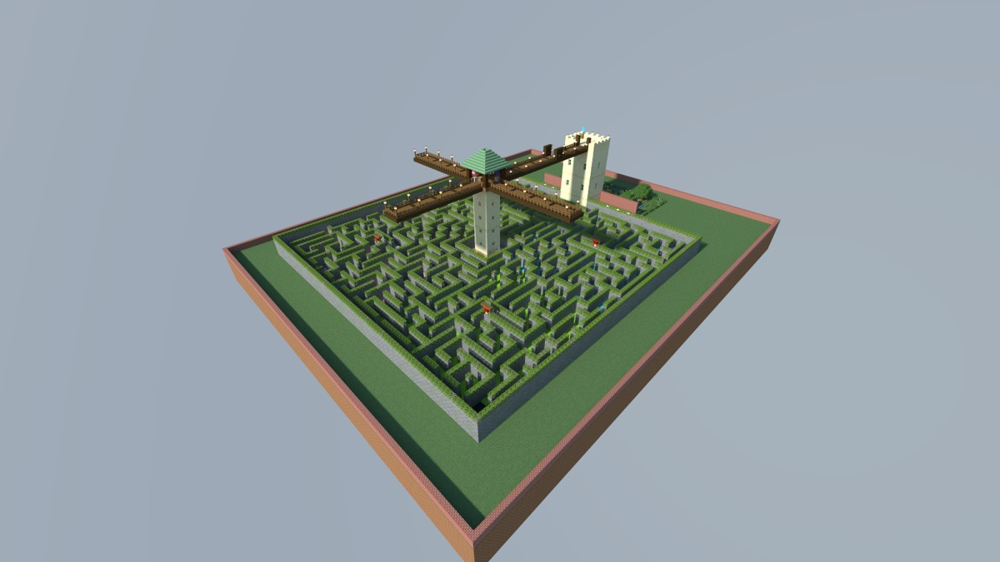
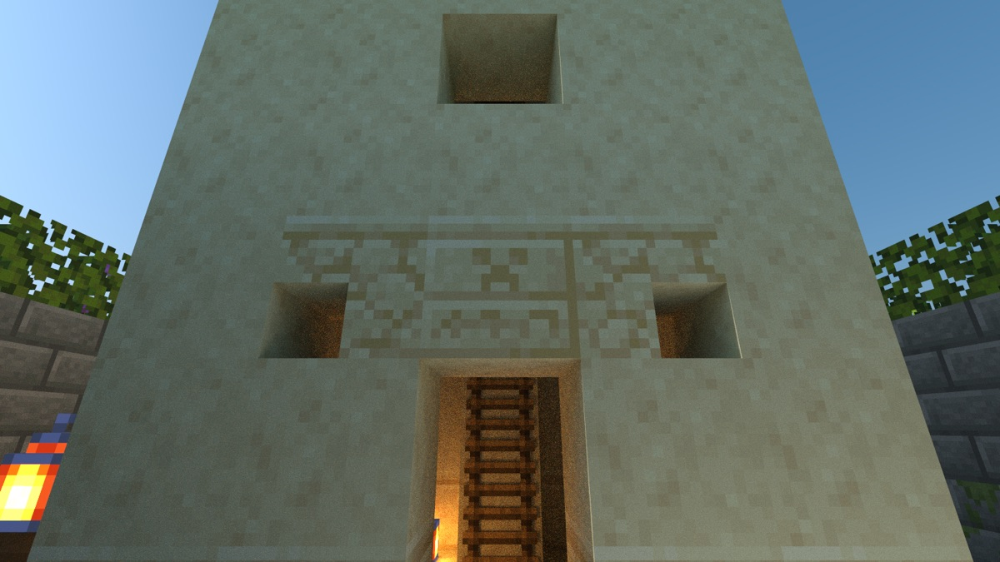
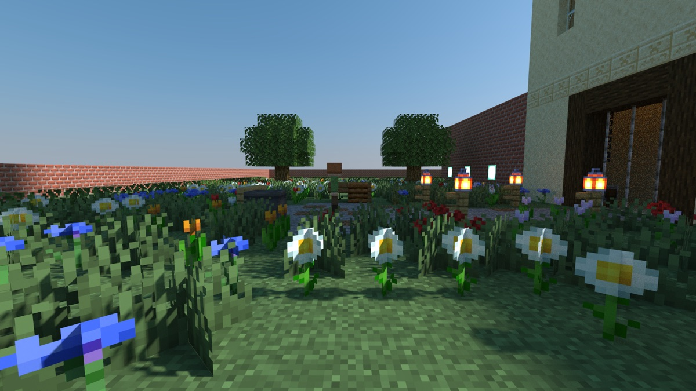

# The Hush Garden

> **Requires delve engine 0.71.0 or newer** — last verified with delvec 1.16.0 on Minecraft Java 1.21.11.



The Hush Garden is a walled hedge maze with a watchtower in its middle. At closing time the head gardener winds the great gate shut, and two friends are still inside, at the foot of the tower. Something old sleeps under the garden's well, and it wakes to footsteps.

| | |
|---|---|
| **Players** | 1–2 |
| **Playtime** | ~25 minutes |
| **Mode** | adventure, no fighting |
| **Languages** | English, 简体中文 (`zh-cn`) |
| **Classes** | two — Runner, Caller |
| **Licence** | CC BY-SA 4.0 |

A small two-player level. Either part can be played alone.



## The parts

- **Runner** — soft-soled boots and bread. Runs the lanes.
- **Caller** — a spyglass, eggs, a bow and arrows. Climbs the watchtower and calls the way.

Talk to each other. The caller can see much more of the maze than the runner can.

## Who you will meet

**Wren Applegate**, the head gardener: quick, warm, and sorry. She has kept the Hush Garden for thirty summers.



## Playing it

Start the server, then in the Minecraft Java client at the version the marker above names: Multiplayer → Direct Connect → `localhost:25565`. Accept the resource pack when you join.

```sh
docker run -d --name delve -p 25565:25565 -v delve-data:/data \
  -e EULA=TRUE ghcr.io/stellarfeline/delve-the-hush-garden:latest
```

The release page carries the exact version of each image.

Add `-e DELVE_RESET_WHEN_EMPTY=90` and the world is thrown away and built again from the image once nobody has been online for 90 seconds, so the next arrival starts a delve nobody has touched — but then EVERY start resets, and restarting the container under a party ends that party's run. Leave it out and the world is kept. The floor is 60 seconds; below it the server refuses to start.
