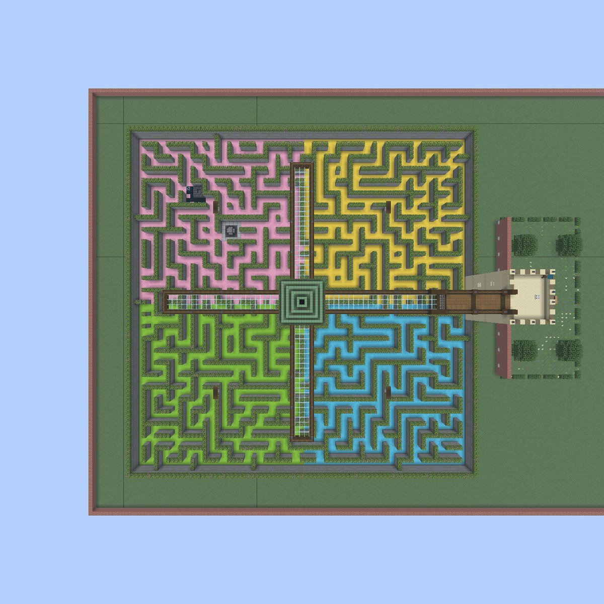
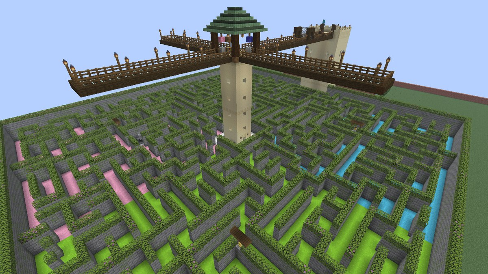

# 静谧花园

> **Requires delve engine 0.71.0 or newer** — last verified with delvec 1.16.1 on Minecraft Java 1.21.11.
> 需要上面标注版本或更新的 delve 引擎。



静谧花园是一座围墙环绕的树篱迷宫，正中立着一座瞭望塔。闭园时，园丁长把大门绞上了——可还有两个朋友留在里面，就在塔脚下。花园的老井下面睡着一个古老的东西，脚步声会把它吵醒。

| | |
|---|---|
| **人数** | 1–2 人 |
| **时长** | 约 25 分钟 |
| **模式** | 冒险模式，不打架 |
| **语言** | English、简体中文（`zh-cn`） |
| **职业** | 两种：奔跑者、呼叫者 |
| **许可** | CC BY-SA 4.0 |

这是一关双人小关卡。两个角色都可以一个人玩。



## 两个角色

- **奔跑者**——软底靴和面包。在小路里奔跑。
- **呼叫者**——望远镜、鸡蛋、弓和箭。爬上瞭望塔，为同伴指路。

多和同伴说话。呼叫者能看到的迷宫比奔跑者多得多。

## 你会遇到的人

**雷恩·阿普尔盖特**，园丁长：说话快、心肠热，总在道歉。她照看静谧花园已经三十个夏天了。

## 怎么玩

启动服务器，然后用上面标注的版本的 Minecraft Java 客户端：多人游戏 → 直接连接 → `localhost:25565`。进入时请接受资源包。

```sh
docker run -d --name delve -p 25565:25565 -v delve-data:/data \
  -e EULA=TRUE ghcr.io/stellarfeline/delve-the-hush-garden:latest
```

每个镜像的确切版本见发布页。

加上 `-e DELVE_RESET_WHEN_EMPTY=90` 后，服务器空无一人 90 秒，世界就会被丢弃并从镜像重建，下一位到来的玩家会从一个没人动过的关卡开始——但这样每次启动都会重置，在玩家游戏途中重启容器会结束他们这一局。不加这一项，世界就会保留。最小值是 60 秒，低于它服务器拒绝启动。
