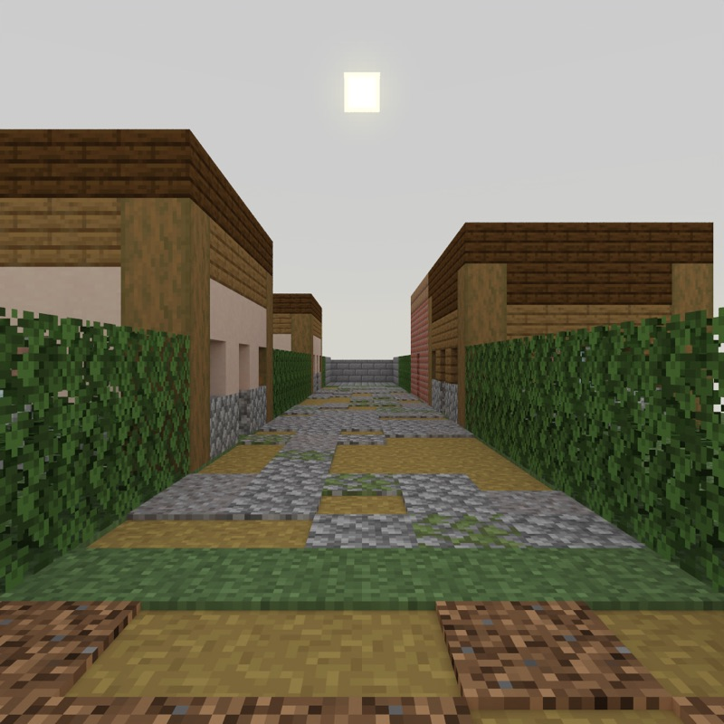
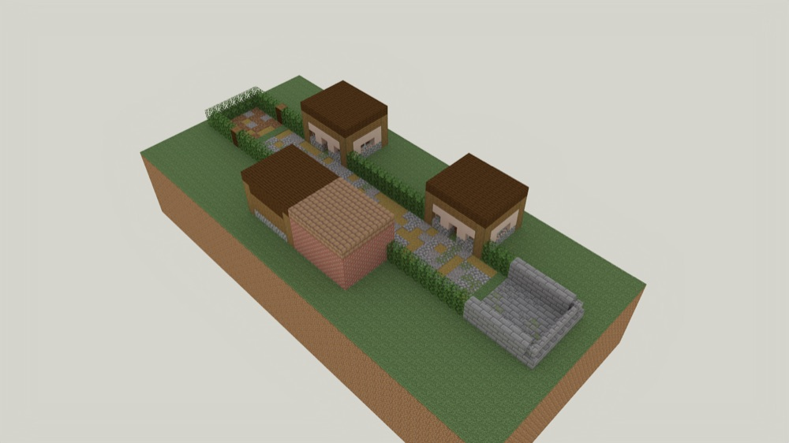

# The Stripped Town

> **Requires delve engine 0.43.0 or newer** — last verified with delvec 1.13.0 on Minecraft Java 1.21.11.



Saltlow was a herring town until the shoals moved off. In the autumn its people
loaded every cart they had and went inland, and they took everything that
would carry. One man stayed on for one more tide: Ansel Tarrow, who keeps the
ferry, and who will not sail without the parcel his sister left behind.

A demo level of about ten minutes, for one to four players. No combat.

## Who you will meet

- **Ansel Tarrow** keeps the Saltlow ferry. He wrote the letter that brought
  you here, and he is waiting on the quay with one eye on the tide.

## Classes

- **Carrier** — Ansel's letter and a lantern. You carry what other people
  cannot come back for.

## Playing it

Start the server, then in the Minecraft Java client at the version the marker
above names: Multiplayer → Direct Connect → `localhost:25565`. Accept the
resource pack when the server offers it.



---

## For the owner: what to look for

This level is where declared containers (spec-0105) are looked at in the game.
The machine has proved the census — six containers: four scenery (a chest and
a barrel in each of the two stripped houses), one loot (the smoker), one
`collect` (the parcel chest) — that no place mixes scenery with a container
that matters, that no place holds more than two scenery containers, and that
the arrival line reaches the bot between its class command and the warp in.
What it cannot say is how any of it **reads**. Walk it once as a Carrier, and
open whatever you would naturally open.

1. **The arrival line, heard once.** Choose the class. One chat line arrives
   with the sound of a barrel lid closing: *Saltlow went inland in the autumn
   and took everything that would carry. Its barrels and chests stand empty
   now; only what was left on purpose is still here.* Walk down the street.
   Does that one line stop you opening the barrels and chests in the
   net-maker's cottage (first door on the left) and the chandler's shop (first
   door on the right)? If you open them anyway, note whether the empty grid
   felt like the line was true, or like the line was ignored.
2. **The parcel's cupboard reads as the one that matters.** Ansel sends you to
   Marra's house, the last door on the left before the quay, to the chest at
   the foot of her bed. It is the only container in that house. Does it read
   as the one, standing beside the pallet bed, without the hint?
3. **The stocked smoker reads as a find.** The smokehouse (second door on the
   right) is not on the errand. Its smoker, against the back wall, holds a raw
   salmon, a piece of charcoal and two smoked cod in the result slot. Does it
   read as something worth opening in a stripped town, and does the find
   surprise you after the arrival line? Taking the cod lets the smoker light
   and smoke the salmon: watch whether that reads as the smokehouse coming
   back to life.
4. **Each holder reads as part of the room and gives up its item in adventure
   mode.** The chest by Marra's bed and the smoker in the smokehouse are the
   two that hold something. Each should look like furniture that belongs in
   its room, not a box added beside it, and each should open and let you take
   its stacks in adventure mode. (Item frames, armour stands and brewing
   stands are not built: the engine places none of them as a holder yet, and
   the brewing stand is not in the block palette pieces may use.)

### The refusal this level stays inside

The engine refuses a scenery container standing among a container that
matters. A copy of this campaign with one extra barrel in Marra's house — the
parcel chest's room — was built, and the build stopped (exit 3):

```
container census: 7 container cell(s) in the assembled world (minecraft:barrel: 3, minecraft:chest: 3, minecraft:smoker: 1); 1 loot, 1 collect, 0 device, 5 decoration; notice declared; by place: node/chandlers: 2, node/marras-house: 2, node/net-house: 2, node/smokehouse: 1; arrangement: 1 mixed place(s), 0 over the cap of 2 decoration cell(s) per place.
DW1024 [error] build: 1 mixed place(s) and 0 place(s) over the cap of 2 scenery container cell(s): scenery containers stay few, and a container that matters never stands among them.
  MIXED — `node/marras-house`: the container(s) that matter, `minecraft:chest` at [8222, 64, 8197] (collect `obj/fetch-the-parcel`), stand among the scenery container(s) `minecraft:barrel` at [8226, 64, 8198] (scenery). A player searching for what matters opens every one of them. Fill every scenery container in this place so each pays off, replace it in the place's piece or program with furniture that is not a container, or move the one that matters to a place where every container pays off. A trap among loot is allowed; a needed item among empty containers is not.
```

Speak to Ansel with the parcel to finish.
