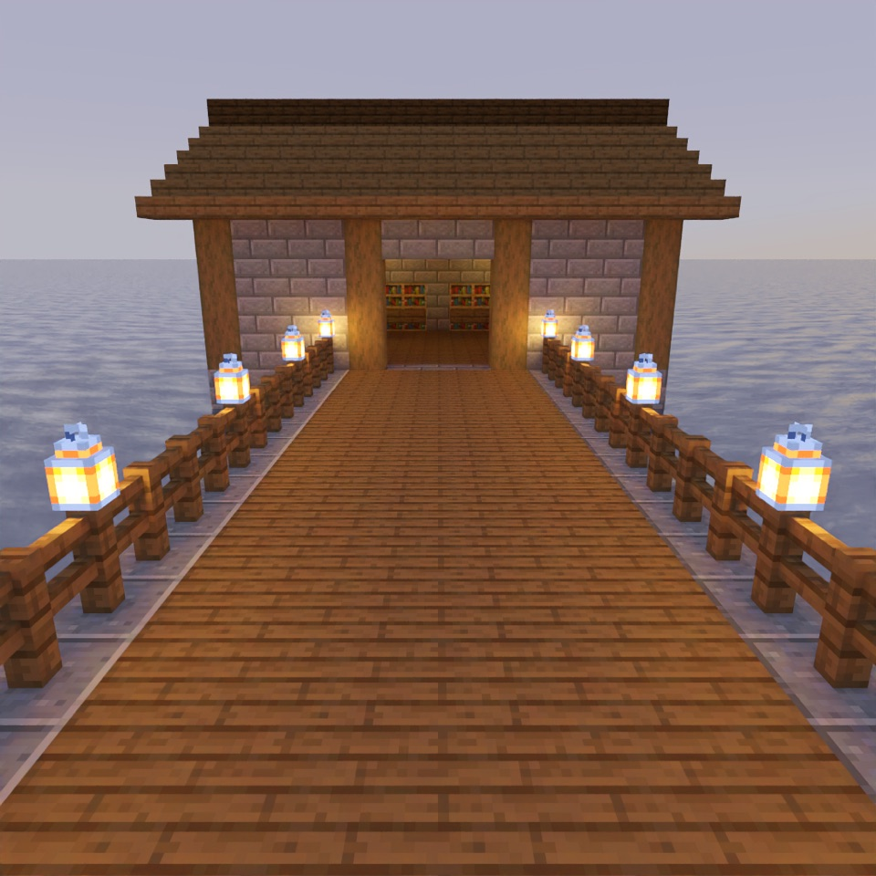

# 水那边的东西

> **Requires delve engine 0.56.0 or newer** — last verified with delvec 1.13.0 on Minecraft Java 1.21.11.

黄昏时分，你沿海岸路来到一片灰蒙蒙的海湾：一道石砌栈桥伸进水里，桥脚下是海港馆，宽大的门敞着；湾里立着一根光秃秃的石柱，没人愿意多看它一眼。

海港馆的看守人奥斯温·马拉布尔，替栈桥尽头那口钟守了三十个冬天。他一次也没敲过。

- **人数**：1 到 4 人。
- **时长**：十分钟左右。
- **职业**：*旅人*——一盏提灯，再加上现在每一关都会发的指南针和日志。

## 开始游戏

启动服务器后，用上方标注版本的 Minecraft Java 客户端：多人游戏 → 直接连接 → `localhost:25565`。

进服时请接受资源包提示：中文文本在资源包里。

## 给主人的看点

这一关是“镜头拍得到它该拍的东西”的演示关。照客户端原样玩一遍；下面每一条是一件要看的事。

1. **看守人有没有从敞开的门里露出来？** 走到馆门口。第一段过场站在门外的栈桥上，正对着门往里看：看守人坐在大厅最里头的桌后，被门框框住，持续四秒。这四秒里，你一直看到的是他，而不是一堵墙或一间空屋吗？
2. **风景镜头像不像这片海湾？** 和看守人说话，再走到栈桥尽头的钟那里。第二段过场从栈桥尽头上方滑出水面，六秒——拍的是这个地方，不拍任何一样东西——然后切到石柱附近的一段慢速掠过，对准柱顶。前半段读起来像不像海湾（水面、地平线、前方的石柱）？后半段石柱是不是一直在画面里？
3. **那东西升起的整个过程，看得见吗？** 敲钟。第三段过场站在钟后的栈桥上，隔着九十格水面望向石柱，十秒；那东西从柱顶升起，从开始到立稳约九秒。它是不是从刚露出岩石的第一帧，一直到镜头的最后一帧都在，没有突然冒出来，也没有闪烁？九十格外看得清吗？构建是按客户端“实体距离”的最低值（50%）给它定大小的：那时它能画到约 124 格，而这一镜头里相机离它从没超过 96.4 格（构建里的 `validation/shot-subjects.json`：`view_range` 3.87，`farthest` 96.376）。
4. **三段过场里，有没有哪一帧拍到的只是空海、天空或一堵墙？**
5. **过场结束后，它还在吗？** 走回栈桥，对着水面望向石柱：那东西应该还立在上面。然后去告诉看守人。

进场时聊天栏里会有一句话说厅里的木桶都空着：只要有容器里什么都没有，引擎就要求说这一句，它不是这一关要看的。

## 被拒绝的写法

旁边还有五种引擎会拒绝的写法——每一种都是成品关卡加一处改动，由同一个 `delvec` 完整打印在 [`refusals/`](refusals/) 里：

| 改动 | 引擎怎么说 |
|---|---|
| 石柱的镜头往上抬了二十格，对着海和天——[`a-shot-of-sea-and-sky.txt`](refusals/a-shot-of-sea-and-sky.txt) | `DW1033`：第 0 刻石柱就不在画面里 |
| 看守人的镜头挪到门边，隔着馆墙拍——[`a-shot-through-the-hall-wall.txt`](refusals/a-shot-through-the-hall-wall.txt) | `DW1033`：九条视线全被挡，最先挡住的是 [8222, 65, 8320] 处的墙 |
| 那东西在过场之后才生成，而不是之前——[`a-thing-not-yet-standing.txt`](refusals/a-thing-not-yet-standing.txt) | `DW1034`：没有任何一拍在过场之前把它放出来 |
| 钟的镜头退到两百格外，视距只有 20 个区块——[`a-figure-two-hundred-blocks-off.txt`](refusals/a-figure-two-hundred-blocks-off.txt) | `DW1034`：202 格，而追踪范围是 160 |
| 看守人的镜头删掉了它的 `subject`——[`a-shot-that-names-nothing.txt`](refusals/a-shot-that-names-nothing.txt) | `DW0199`：这个镜头没有声明拍摄对象 |
